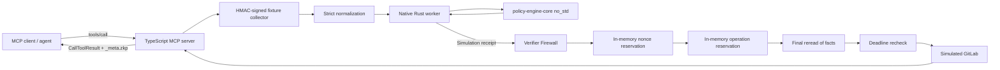
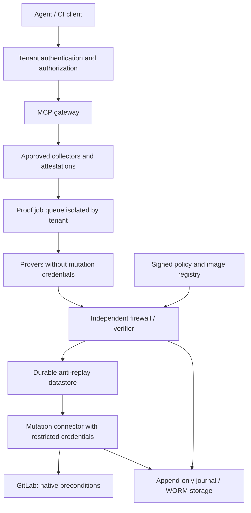
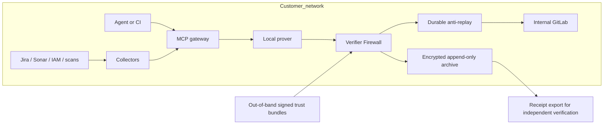

# Architecture and decisions

## Bootstrap status

A Cargo/npm monorepo provides an executable POC: official MCP server over stdio,
verification SDK, persistent Rust worker, deterministic core and fixture
connectors. Production mode is blocked. ZK backends, real connectors, durable
audit storage and production deployment are work explicitly tracked in `issues/`.

The opt-in `labs/risc0` testbed adds a real RISC Zero guest and adapter,
with independent verification of a fixture attestation. It is separate from
the demonstration MCP server. The common relation now resides in
`crates/policy-statement` (`no_std + alloc`); neither hashes nor rules are
reimplemented in the lab. See [the security model](07-STACK-SECURITY-AND-PERFORMANCE.md).

The core evaluates the basic rule and the critical profile detailed in
`05-CRITICAL-PLATFORM-POLICY.md`. TypeScript does not reimplement business
decisions. The firewall checks server expectations, freshness and expiration
at execution time; these checks remain necessary even with a valid
cryptographic proof.

Operation reservation binds audience, tenant, project, MR and SHA independently
of the nonce. Two fresh challenges for the same change therefore cannot trigger
two mutations in this instance. The `RESERVED`, `COMPLETED`, `UNKNOWN` and
`REJECTED` states remain consumed; the in-memory store does not survive a restart.
Issue 08 covers durability and reconciliation.

Additional research narrows the product target to confidential admission
between organizations: see [the proposed pilot](06-MARKET-NICHE-AND-CHALLENGE.md).
The architectures below remain deployment targets, with no confidentiality
guarantee already delivered.

## Module boundaries

| Module | Responsibility | Cannot do |
|---|---|---|
| `policy-engine-core` | Comparisons, denial masks, critical profile; no heap/network/clock | Collect source evidence or perform a merge |
| `policy-statement` | Types, formats, commitments and journal shared by backends; `no_std + alloc` | Read actual time or authenticate an external source on its own |
| `policy-guest-riscv` | Adapt the core to an execution interface; bare feasibility ELF | Claim already delivered SP1/RISC Zero ABI support |
| `zkvm-bridge` | Encoding, commitments, trait, simulation, bounded JSONL protocol | Access API credentials |
| `@zk-mcp/sdk` | Schemas, worker, verification, MCP hooks, nonce reservation | Trust an image/policy supplied by the agent |
| `enterprise-gateway` | Authorize the project, collect, prove, verify, reread, mutate | Expose a merge bypass or connect a live API in the demo |

The worker receives JSONL messages with `request_id`, `op`, `payload`; operations
are `image_id`, `prove`, `verify`. These messages trigger no shell or code
download. Maximum size is 2 MiB, with a queue of at most 64 requests and a
default timeout of 10 s. This local worker is a simulator convenience, not a
confidentiality boundary against the same OS user.

## SaaS target — not deployed

The agent and prover are outside the authorization boundary. Source authority,
image registry, verifier, clock, datastore and mutation connector remain trusted
components. Private data sent to a SaaS prover remains visible to that prover.
Prefer a prover within the customer's perimeter if the witness is confidential.

Requirements before production: per-tenant AuthN/AuthZ, resource limits,
collector signing/rotation, reproducible ELF generation, pinned vkeys, real ZK
proofs, transactional anti-replay store, reconciliation of ambiguous mutations
and GitLab enforcement at the mutation point.

## On-premises target — not deployed

Offline operation can verify a past proof with pinned keys. It cannot guarantee
that Jira, approvals or the emergency stop have not changed since collection.
The crisis policy must explicitly define acceptable freshness and the actions
blocked when authoritative sources are unavailable; the POC rejects expired facts.

## Architecture decisions

1. **One business logic core.** Rust policies do not depend on any backend.
   Comparisons are bounded and use integers (ppm for errors).
2. **Explicit simulation.** A native receipt reveals the witness and does not
   protect against a malicious cryptographic prover. A missing backend returns
   `BACKEND_UNAVAILABLE`, never an implicit fallback.
3. **Source portability.** Each real zkVM needs its own ABI, journal, toolchain
   and program identity. No universal ELF.
4. **Verify before mutation.** The preparation function is read-only; the effect
   hook is invoked only after verification and nonce reservation.
5. **No invented exactly-once guarantee.** A timeout may leave an external result
   unknown. Keep the nonce consumed, record the state and reconcile.
6. **Authenticity separate from computation.** Local HMAC today; verifiable
   source attestations and collection policies still to be built.
7. **Compatible metadata.** `_meta.zkp` extension and MCP content retained.
   Requested SDK version V1 pinned; migration to V2 before stable release.
8. **Measured latency.** Rejections and verification separated. Neither Magnetar
   nor simulator figures measure the future service.

## Source adapters: contract to implement

The Jira connector must resolve the ticket associated with the change on the
server side and map allowed statuses through versioned configuration. Sonar
must provide the quality gate of an identified analysis tied to the same commit;
a `PENDING` analysis or an incomplete scan does not mean zero vulnerabilities.
GitLab must provide distinct approvers, applicable rules and the current SHA.
Critical roles must come from IAM, and restoration / rollback evidence from
identified executions.

The delivered normalizer schemas test response fragments, not complete
acquisition. Future HTTP adapters require a configured origin, timeouts, response
limits, complete pagination, TLS validation, rejection of cross-origin redirects
and no blind retries on mutation.

Contract sources: [Jira REST v3](https://developer.atlassian.com/cloud/jira/platform/rest/v3/api-group-issues/),
[Sonar Web API](https://docs.sonarsource.com/sonarqube-server/extension-guide/web-api),
[GitLab merge requests](https://docs.gitlab.com/api/merge_requests/).
Jira web access failed during the session: verify the exact contract on the
target instance during implementation. GitLab exposes a `sha` parameter to
condition the merge on HEAD; it does not make the other services transactional.

## Deployment and quality

The delivered CI compiles Rust and TS, runs tests, applies Clippy/rustfmt,
generates the schema and compiles the feasibility ELF. Tests require no key
or cloud service. No production Docker setup is presented as ready: issue 10
depends on the production controls in issues 07–09.
