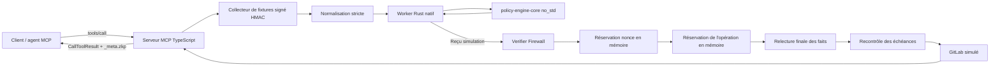
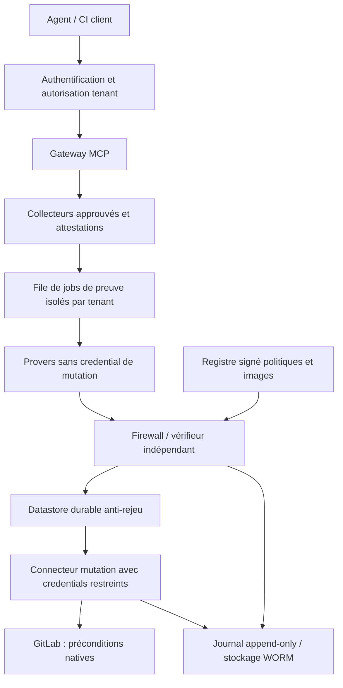
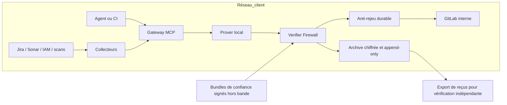

# Architecture et décisions

## État du bootstrap

Un monorepo Cargo/npm fournit un POC exécutable : serveur MCP officiel sur stdio,
SDK de vérification, worker Rust persistant, noyau déterministe et connecteurs
de fixtures. Le mode de production est bloqué. Les backends ZK, connecteurs
réels, stockage d'audit durable et déploiement de production sont des travaux
explicitement suivis dans `issues/`.

Le banc opt-in `labs/risc0` ajoute un guest et un adaptateur RISC Zero réels,
avec vérification indépendante d'une attestation de fixture. Il est distinct
du serveur MCP de démonstration. La relation commune est désormais dans
`crates/policy-statement` (`no_std + alloc`) ; ni hashes ni règles ne sont
réimplémentés dans le lab. Voir [le modèle de sécurité](07-STACK-SECURITY-AND-PERFORMANCE.md).

Le noyau évalue la règle simple et le profil critique détaillé dans
`05-CRITICAL-PLATFORM-POLICY.md`. TypeScript ne réimplémente pas les décisions
métier. Le firewall contrôle les attentes serveur, la fraîcheur et l'expiration
au moment de l'exécution ; ces contrôles restent nécessaires même avec une
preuve cryptographique valide.

La réservation d'opération lie audience, tenant, projet, MR et SHA, indépendamment
du nonce. Deux challenges frais pour le même changement ne peuvent donc pas
déclencher deux mutations dans cette instance. Les états `RESERVED`, `COMPLETED`,
`UNKNOWN` et `REJECTED` restent consommés ; le store mémoire ne survit pas à un
redémarrage. L'issue 08 couvre la durabilité et la réconciliation.

La recherche complémentaire resserre la cible produit sur l'admission
confidentielle entre organisations : voir
[le pilote proposé](06-MARKET-NICHE-AND-CHALLENGE.md). Les architectures ci-dessous
restent des cibles de déploiement, sans garantie de confidentialité déjà livrée.

## Frontières des modules

| Module | Responsabilité | Ne peut pas faire |
|---|---|---|
| `policy-engine-core` | Comparaisons, masques de refus, profil critique ; sans heap/réseau/horloge | Collecter les preuves d'origine ou effectuer un merge |
| `policy-statement` | Types, formats, engagements et journal communs aux backends ; `no_std + alloc` | Lire l'heure réelle ou authentifier une source externe à lui seul |
| `policy-guest-riscv` | Adapter le cœur à une interface d'exécution ; ELF nu de faisabilité | Affirmer un support ABI SP1/RISC Zero déjà livré |
| `zkvm-bridge` | Encodage, engagements, trait, simulation, protocole JSONL borné | Accéder à des credentials d'API |
| `@zk-mcp/sdk` | Schémas, worker, vérification, hooks MCP, réservation de nonce | Faire confiance à une image/politique fournie par l'agent |
| `enterprise-gateway` | Autoriser le projet, collecter, prouver, vérifier, relire, muter | Exposer un bypass de merge ou brancher une API live dans la démo |

Le worker reçoit des messages JSONL avec `request_id`, `op`, `payload` ; les
opérations sont `image_id`, `prove`, `verify`. Aucun shell ni téléchargement
de code n'est déclenché par ces messages. Taille maximale 2 MiB, file de 64
requêtes au plus, timeout par défaut de 10 s. Ce worker local est une commodité
du simulateur, pas une frontière de confidentialité face au même utilisateur OS.

## Cible SaaS — non déployée

L'agent et le prover sont hors de la frontière d'autorisation. L'autorité des
sources, le registre d'images, le vérifieur, l'horloge, le datastore et le
connecteur de mutation demeurent des éléments de confiance. Les données
privées envoyées à un prover SaaS restent visibles de ce prover. Préférer un
prover dans le périmètre du client si le witness est confidentiel.

Les éléments attendus avant production : AuthN/AuthZ par tenant, limites de
ressources, signature/rotation des collecteurs, génération reproductible des
ELF, vkeys épinglées, preuves ZK réelles, store transactionnel anti-rejeu,
réconciliation des mutations ambiguës et contrôle GitLab au point de mutation.

## Cible on-premise — non déployée

Un fonctionnement hors réseau peut vérifier une preuve passée avec des clés
épinglées. Il ne peut pas garantir que Jira, les approbations ou l'arrêt d'urgence
n'ont pas changé depuis la collecte. La politique de crise doit définir
explicitement la fraîcheur admissible et les actions bloquées en l'absence de
sources autoritatives ; le POC refuse les faits expirés.

## Décisions d'architecture

1. **Un seul cœur métier.** Les politiques Rust ne dépendent d'aucun backend.
   Les comparaisons ont des bornes et utilisent des entiers (ppm pour les erreurs).
2. **Simulation explicite.** Un reçu natif révèle le witness et ne protège pas
   contre un faux prover cryptographique. Un backend absent retourne
   `BACKEND_UNAVAILABLE`, jamais un fallback implicite.
3. **Portabilité de sources.** Chaque véritable zkVM nécessite son ABI, son
   journal, sa toolchain et son identité de programme. Pas d'ELF universel.
4. **Vérifier avant mutation.** La fonction de préparation est en lecture ; le
   hook d'effet n'est invoqué qu'après vérification et réservation du nonce.
5. **Pas d'exactly-once inventé.** Un timeout peut laisser un résultat externe
   inconnu. Garder le nonce consommé, enregistrer l'état et réconcilier.
6. **Authenticité séparée du calcul.** HMAC local aujourd'hui ; attestations
   d'origine vérifiables et politiques de collecte à construire.
7. **Métadonnées compatibles.** Extension `_meta.zkp` et contenu MCP conservé.
   Version SDK demandée V1 épinglée ; migration V2 avant publication stable.
8. **Latence mesurée.** Rejets et vérification séparés. Ni les chiffres Magnetar
   ni ceux du simulateur ne sont des mesures du futur service.

## Source adapters : contrat à réaliser

Le connecteur Jira doit résoudre le ticket associé au changement côté serveur
et mapper des statuts autorisés via une configuration versionnée. Sonar doit
fournir le quality gate d'une analyse identifiée, rattachée au même commit ; une
analyse `PENDING` ou un scan incomplet ne valent pas zéro vulnérabilité.
GitLab doit fournir approbateurs distincts, règles applicables et SHA courant.
Les rôles critiques doivent venir d'un IAM, et les preuves de restauration /
rollback d'exécutions identifiées.

Les schémas des normalizers livrés testent des fragments de réponses, pas une
acquisition complète. Les futurs adaptateurs HTTP exigent origine configurée,
timeouts, limites de réponse, pagination complète, validation TLS, refus de
redirection vers une autre origine et absence de retries aveugles sur mutation.

Sources de contrats : [Jira REST v3](https://developer.atlassian.com/cloud/jira/platform/rest/v3/api-group-issues/),
[Sonar Web API](https://docs.sonarsource.com/sonarqube-server/extension-guide/web-api),
[GitLab merge requests](https://docs.gitlab.com/api/merge_requests/).
L'accès web Jira a échoué pendant la session : vérifier le contrat exact sur
l'instance cible à l'implémentation. GitLab expose un paramètre `sha` pour
conditionner le merge au HEAD ; il ne rend pas les autres services transactionnels.

## Déploiement et qualité

La CI livrée compile Rust et TS, teste, applique Clippy/rustfmt, génère le schéma
et compile l'ELF de faisabilité. Les tests ne nécessitent aucune clé ni service
cloud. Aucun Docker de production n'est présenté comme prêt : l'issue 10 est
conditionnée par les contrôles de production des issues 07–09.
