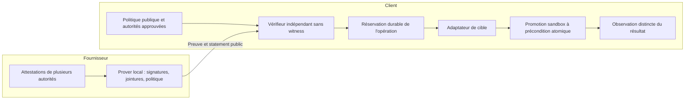

# Équivalents, niche et contradiction — 15 octobre 2026

Complément expérimental ultérieur : [quatre preuves RISC Zero et leurs
mesures](08-RISC0-LAB-RESULTS.md). Ce laboratoire à autorité synthétique ne
remplace pas le pilote fournisseur-client décrit ici.

## Décision

**GO pour préparer un pilote comparatif sandbox ; NO-GO pour annoncer un
marché vierge, un standard mondial ou un produit prêt pour plateforme critique.**
Cette recherche corrige le positionnement initial. Les constituants de l'idée
existent déjà, et plusieurs concurrents en réunissent une grande partie.

Piste retenue, encore hypothétique : **un adaptateur d'admission confidentielle
de promotions d'artefacts entre un fournisseur et son client, branché sur leur
point de contrôle existant, avec preuve complète vérifiée avant l'effet et
reprise après panne testée sur une cible concrète**.

L'innovation ne peut pas être affirmée sur la seule présence de MCP, de Rust,
de ZK, d'un nonce, de vérification hors ligne ou de preuves supply-chain privées.
Le choix d'une zkVM au lieu de circuits spécialisés n'est pas en lui-même un
avantage acheteur. « Aucun flux exact démontré dans les sources consultées »
ne signifie pas « aucun produit ne sait le faire ».

## 1. Méthode et niveau de preuve

Trois agents contradicteurs ont travaillé sur concurrence, technique/
confidentialité et acheteur/crise. Ils ont effectué une première recherche,
puis un second tour sur un positionnement plus étroit. Le contradicteur
technique a reproduit les défauts et vérifié leurs corrections.

Sources primaires seulement pour les affirmations techniques : documentation
des éditeurs, dépôts, publications et règlements. Les pages consultées sont
datées ci-dessous quand cette date est disponible. Les services commerciaux
authentifiés n'ont pas été essayés ; aucun concurrent n'a fait l'objet d'un
audit cryptographique indépendant dans cette session. Aucun prospect n'a été
contacté. La demande solvable et les prix acceptables restent inconnus.

## 2. Matrice des équivalents

| Équivalent et source | Recouvrement établi par la source | Limite de notre constat |
|---|---|---|
| [ICME PreFlight](https://www.icme.io/product), page courante | Contrôle avant action, API/MCP, reçus ZK, politique/faits privés annoncés ; la page distingue le verdict immédiat d'une preuve terminant en arrière-plan | Véracité des faits déclarés non établie par le reçu ; aucune expérimentation de leur API ici |
| [Colofon](https://colofon.tech/), [whitepaper v0.2, avril 2026](https://colofon.tech/whitepaper/v0.2) | Fournisseur → acheteur, digest d'artefact, preuves composées sur sources signées, politique spécifique du client, vérification locale et données privées | Concurrent le plus proche ; admission effective de la mutation et reprise de cible non démontrées dans les documents examinés |
| [Colofon Agent public](https://github.com/colofonhq/colofon-agent), [Action](https://raw.githubusercontent.com/colofonhq/colofon-agent/main/action.yml) | Intégration CI inspectable ; chemin de compilation de provenance ; dépendances privées requérant un accès | Pipeline complet non reproduit ; absence d'accès n'est pas une preuve d'absence de fonctionnalité |
| [Prezta, juillet 2026](https://arxiv.org/abs/2607.11466), [code](https://github.com/walotta/ZK_Zero_Trust) | Politiques XACML compilées en Rust, exécution RISC Zero, vérification JWT pour autorisation d'infrastructures OT | Antériorité directe du moteur de politique zkVM ; confidentialité et rejeu réseau ne constituent pas les garanties démontrées par l'étude |
| [KedgeFlow, octobre 2026](https://arxiv.org/abs/2610.14810), [spécification v0.9](https://www.openkedge.io/paper/kedgeflow) | Contrôle exact-action, autorisation consommable, contrôle cible, résultats inconnus, MCP, règles de reprise et crise | Spécification/prototype ; les auteurs distinguent essais locaux et qualification production |
| [Bolyra](https://bolyra.ai/), [code public](https://github.com/bolyra/bolyra) | Gateway, délégation, anti-rejeu, reçus signés, vérifieurs et primitives ZK annoncées | Ne pas réduire toute l'offre à une simple signature ; l'équivalence de notre relation métier n'a pas été testée |
| [Microsoft AGT/ACS](https://github.com/microsoft/agent-governance-toolkit/blob/main/policy-engine/spec/SPECIFICATION.md) | Cœur Rust déterministe, refus bloquant, approbations liées à l'action et champ d'evidence | Une evidence opaque n'est pas une preuve ZK vérifiée par ce runtime |
| [Automata SLSA/Sigstore verifier](https://github.com/automata-network/automata-slsa-sigstore-verifier) | Rust, DSSE, X.509/Fulcio, Rekor/OIDC, backends RISC Zero/SP1/Pico | Antériorité du bridge multi-zkVM sur attestations ; réutilisation à examiner |
| [zk-MCP, décembre 2025](https://arxiv.org/abs/2512.14737) | Audit confidentiel des communications d'agents avec MCP | Le nom et le concept général préexistent à ce dépôt |
| [Sigstore policy-controller](https://docs.sigstore.dev/policy-controller/overview/), [Cedar](https://docs.cedarpolicy.com/auth/authorization.html), [OPA decision logs](https://www.openpolicyagent.org/docs/management-decision-logs) | Admission, politique déterministe, vérification d'attestations et logs avec masquage | Alternatives de référence ; masquer les données ne prouve pas leur calcul, mais peut suffire au client |
| [GitLab deployment approvals](https://docs.gitlab.com/ci/environments/deployment_approvals/), [Kosli](https://www.kosli.com/devops-change-management/) | Approbations et dossiers de changement/audit | Substituts achetés pour le même travail, même sans ZK |
| [W3C BBS, CR Draft 10 septembre 2026](https://www.w3.org/TR/vc-di-bbs/) | Divulgation sélective et preuves dérivées non corrélables | À comparer à ZK arbitraire ; la confidentialité sélective n'est pas une nouveauté du projet |

D'autres publications réduisent encore les revendications générales :
[Guarded Commits](https://arxiv.org/abs/2610.00037) étudie les approbations liées
à l'effet ; [Offline-Verifiable Accountability](https://arxiv.org/abs/2608.28542)
traite l'audit entre organisations hors ligne ;
[Authority-Set Integrity](https://arxiv.org/abs/2610.15137) rappelle que
l'approbation doit couvrir les autres entrées influençant réellement l'exécution.
Ce sont des antériorités scientifiques, pas des preuves d'adoption commerciale.

## 3. Ce qui est abandonné et ce qui reste à éprouver

| Revendication initiale | Décision |
|---|---|
| Premier zk-MCP mondial | Abandonnée : antériorité du nom et du concept |
| Aucun contrôle cryptographique avant outil | Abandonnée : plusieurs approches proches |
| Policy Rust dans une zkVM pour infrastructure critique | Non distinctif : Prezta notamment |
| Conformité logicielle sans partager les preuves brutes | Non exclusif : Colofon notamment |
| Offline, nonce, exact-action et reprise | Mécanismes existants, à composer et qualifier |
| Magnetar rend tout post-quantique et <5 ms | Non démontré ; aucun backend Magnetar disponible ici |
| Adapter une preuve privée à une cible précise, avec reprise démontrée | Hypothèse d'intégration à tester, pas marché vierge établi |

Colofon peut être un fournisseur de preuves pour cet adaptateur plutôt qu'un
produit à reconstruire. Si son bundle associé au même contrôleur satisfait
les exigences, cette intégration doit être préférée. PreFlight associé à un
point d'application existant est une autre baseline. Attendre la fin d'une
preuve avant l'appel API est facilement copiable ; ce n'est pas une barrière
concurrentielle suffisante.

## 4. Niche proposée et relation de confiance

**Premier cas à qualifier** : un fournisseur de logiciel ou opérateur de service
doit promouvoir un artefact immuable chez un client banque/assurance. Le client
veut appliquer sa politique à des attestations qu'il accepte, mais ne veut pas
croire le seul verdict calculé par le fournisseur. Les valeurs des attestations
ne peuvent pas être exportées telles quelles.

Les deux organisations doivent confirmer ce **même dossier bloqué** :

- Le fournisseur montre les champs effectivement non partageables et le temps
  de revue/export actuel : inventaire, détails de sécurité, identités ou autres clients.
- Le client nomme la règle, ses autorités factuelles acceptées, le décideur et
  le coût d'un refus/retard. Il explique pourquoi un verdict signé ne lui suffit pas.

Une préférence pour la confidentialité ou un intérêt pour ZK ne suffit pas.
La faiblesse commerciale la plus dangereuse est qu'un verdict DSSE signé,
des pièces filtrées sous NDA ou BBS satisfassent déjà le contrôle à moindre coût.

### Architecture minimale du pilote futur

Le statement doit lier : tenant/client, artefact digest, environnement, cible,
version de ressource attendue, configuration/manifests/workflow influents,
politique/epoch, identité d'opération, engagement des attestations, fenêtre de
validité et divulgations autorisées. Une merge request n'est pas un déploiement :
le POC actuel ne réalise pas cette promotion.

Le guest réel doit vérifier signatures et jointures **dans la relation prouvée**.
Il doit aussi vérifier la couverture attendue : sources requises, scan terminé,
configuration, sujet et période. Sinon un prover pourrait omettre le mauvais
rapport. « Aucun finding dans ce scan identifié » ne signifie pas « aucun défaut ».
Les [statements in-toto](https://github.com/in-toto/attestation/blob/main/spec/v1/statement.md)
constituent une base existante pour lier des prédicats aux digests d'artefacts.

### Confidentialité par acteur

| Acteur | Ce qu'il verra dans le pilote visé |
|---|---|
| Fournisseur/prover local | Witness complet ; ZK ne lui cache rien |
| Autorité factuelle | Les faits qu'elle a observés/attestés |
| Client vérifieur | Politique publique, statement, verdict, preuve et métadonnées définies |
| Agent | Proposition et résultat autorisés ; aucun credential de mutation |
| Auditeur | Bundle exporté ; originaux accessibles selon une procédure gouvernée |

Ne pas promettre de cacher politique, identité de cible, verdict, temps ou
taille de preuve si le profil les expose. Les motifs détaillés et des requêtes
répétées sur des seuils adaptables peuvent révéler progressivement des faits.
La politique doit être approuvée/versionnée, les requêtes bornées et le profil
de divulgation explicite. La simulation actuelle révèle le witness et ne
démontre donc aucune confidentialité interentreprises.

## 5. Crise : une exigence d'exploitation, pas un label ZK

Le profil livré bloque les changements ordinaires pendant un incident majeur.
Il n'est pas un chemin de remédiation. Un rollback d'urgence doit être une
action séparée, sélectionnée par une autorité habilitée, vers un artefact déjà
autorisé et avec portée/fenêtre/incident précis. Aucun bypass choisi par le LLM.

Le [RTS DORA 2024/1774, article 17](https://eur-lex.europa.eu/legal-content/EN/TXT/?uri=CELEX%3A32024R1774)
traite notamment procédures protégées de changements d'urgence et leur revue.
Il ne demande pas de ZK. Les [changements urgents Jira Service Management](https://support.atlassian.com/jira-service-management-cloud/docs/what-are-changes/)
sont déjà une catégorie métier ; leur existence ne valide pas notre marché.

Les essais de crise du futur pilote porteront sur : panne du prover, sources
indisponibles, horloge, clés expirées, store partitionné, réponse API perdue,
restauration d'une sauvegarde et redémarrage. Une autorité consommée ne doit pas
réapparaître après restauration ; une issue UNKNOWN reste inconnue jusqu'à
réconciliation. Ces garanties relèvent du stockage et de la cible.

Hors réseau, on peut vérifier des observations historiques et un bundle de
confiance daté. On ne peut pas garantir l'absence d'une révocation distante ou
un état actuel inaccessible. Une preuve produite après une action peut aider
l'audit, mais ne peut pas être présentée comme l'autorisation ZK préalable.

## 6. Journal des contradictions et corrections

| Tour | Objection | Décision / preuve observable |
|---|---|---|
| Recherche 1 | Antériorités très proches : Prezta, Colofon, KedgeFlow, AGT | Abandon des revendications générales ; matrice primaire ci-dessus |
| Technique 1 | Deux challenges neufs pour la même opération donnaient deux merges simulés | Ajout d'un store d'opérations ; test 32 demandes / une mutation |
| Technique 1 | Rust acceptait des statuts ASCII de contrôle refusés par TS | Alignement ASCII imprimable, corpus de rejet commun |
| Confidentialité 1 | Booléens du collecteur non liés aux preuves d'origine | Maintien du statut fixture ; vérification des attestations dans le guest requise pour le pilote |
| Crise 1 | Gel Sev1 interdit aussi la remédiation | Profil normal conservé ; voie recovery distincte, non livrée |
| Marché 2 | Colofon couvre déjà le fournisseur/client et la composition privée | Le pilote compare une intégration Colofon au lieu de supposer sa faiblesse |
| Technique 2 | Expiration pendant l'attente de réservation autorisait encore le dispatch | Nouvelle vérification après réserve ; tests +11 s/+31 s : zéro mutation, état REJECTED conservé |
| Technique 3 | Relecture des correctifs et tests ciblés | Build réussi, 14/14 tests ciblés ; pas de défaut bloquant supplémentaire identifié dans ces corrections |
| Acheteur 2 | Personne ne paiera peut-être la garantie supplémentaire | Qualification conjointe et comparaison obligatoire avant industrialisation |

Ces revues ne sont pas un audit de sécurité exhaustif. Les corrections sont
testées dans le processus local ; crash/multi-instance et vraies preuves restent
des critères de pilote, pas des garanties déjà obtenues.

## 7. Expérience falsifiable et critères d'arrêt

1. **Qualifier** un fournisseur et un client sur cinq changements autorisés ou
   synthétisés. Identifier les mêmes exigences, les champs non partageables,
   le propriétaire du contrôle et le coût de revue.
2. **Comparer** à périmètre égal : pièces filtrées + signatures, verdict DSSE,
   divulgation BBS, preuve ZK ; inclure Colofon/PreFlight avec le même point
   d'application si leurs offres sont accessibles.
3. **Prouver réellement** signatures, jointures et règle client sur une seule
   promotion sandbox. Mesurer génération/vérification, mémoire, coût complet,
   temps humain et divulgations. Le budget de latence vient du processus métier.
4. **Attaquer** mauvaise source/signature, rapport omis, autre artefact/cible,
   politique obsolète, rejeu, deux challenges, deadline franchie à chaque attente,
   partition, réponse perdue et redémarrage. Zéro mutation non autorisée exigée.
5. **Décider** : poursuivre si un avantage nécessaire et mesuré justifie le coût
   et si un sponsor finance le pilote. Reproduire avec un second couple indépendant
   avant de généraliser le positionnement.

Arrêter la branche ZK si la solution signée suffit, si les faits ne sont pas
authentifiables, si les données sont déjà partageables, si le contrôle peut
être contourné, ou si les coûts ne sont pas acceptables. Devenir adaptateur
d'une solution existante est une issue valide. Aucun résultat web ne permet
de certifier une « idée parfaite » ni une niche définitivement inexistante.

## 8. Position réglementaire

La [consolidation AI Act identifiée au 27 juillet 2026](https://eur-lex.europa.eu/legal-content/EN/TXT/?uri=CELEX%3A02024R1689-20260727)
doit être utilisée pour une matrice juridique actuelle ; l'accès direct a
rencontré un challenge JavaScript pendant la recherche. Aucun calendrier
d'obligation n'est affirmé ici. L'usage d'un agent DevSecOps ne suffit pas
à qualifier automatiquement un système à haut risque.

[DORA article 30](https://eur-lex.europa.eu/legal-content/EN/TXT/?uri=CELEX%3A32022R2554)
prévoit des droits d'accès et d'audit dans les relations concernées. La
minimisation des divulgations courantes n'autorise pas à soustraire les pièces
légitimement exigibles. Le produit envisagé apporte des éléments techniques
d'assurance ; il ne certifie pas à lui seul la conformité réglementaire.
