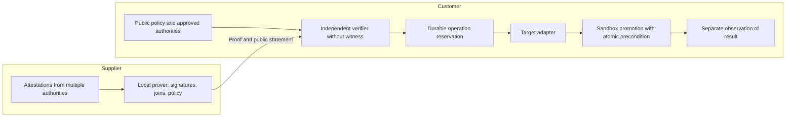

# Alternatives, niche and adversarial review — October 15, 2026

Later experimental supplement: [four RISC Zero proofs and their
measurements](08-RISC0-LAB-RESULTS.md). This laboratory with a synthetic authority
does not replace the supplier–customer pilot described here.

## Decision

**GO to prepare a comparative sandbox pilot; NO-GO to announce an untapped
market, a global standard or a product ready for a critical platform.**
This research corrects the initial positioning. The idea's components already
exist, and several competitors combine a large share of them.

Selected direction, still hypothetical: **an adapter for confidential admission
of artifact promotions between a supplier and its customer, connected to their
existing enforcement point, with the complete proof verified before the effect
and failure recovery tested on a concrete target**.

Innovation cannot be claimed merely from the presence of MCP, Rust, ZK, a nonce,
offline verification or private supply-chain proofs. Choosing a zkVM rather
than specialized circuits is not itself a buyer benefit. “No exact flow
demonstrated in the sources consulted” does not mean “no product can do it”.

## 1. Method and level of evidence

Three challenger agents worked on competition, technology/confidentiality and
buyer/crisis concerns. They conducted an initial search, then a second round
on a narrower positioning. The technical challenger reproduced the defects
and verified their fixes.

Only primary sources support technical claims: vendor documentation,
repositories, publications and regulations. Consulted pages are dated below
when the date is available. Authenticated commercial services were not tried;
no competitor underwent an independent cryptographic audit in this session.
No prospect was contacted. Paying demand and acceptable prices remain unknown.

## 2. Alternatives matrix

| Alternative and source | Overlap established by the source | Limitation of our finding |
|---|---|---|
| [ICME PreFlight](https://www.icme.io/product), current page | Pre-action control, API/MCP, ZK receipts, announced private policy/facts; the page distinguishes the immediate verdict from a proof completing in the background | Truth of declared facts not established by the receipt; no experimentation with its API here |
| [Colofon](https://colofon.tech/), [whitepaper v0.2, April 2026](https://colofon.tech/whitepaper/v0.2) | Supplier → buyer, artifact digest, composed proofs over signed sources, customer-specific policy, local verification and private data | Closest competitor; effective admission of the mutation and target recovery not demonstrated in the documents examined |
| [Public Colofon Agent](https://github.com/colofonhq/colofon-agent), [Action](https://raw.githubusercontent.com/colofonhq/colofon-agent/main/action.yml) | Inspectable CI integration; provenance build path; private dependencies requiring access | Full pipeline not reproduced; lack of access is not evidence of a missing feature |
| [Prezta, July 2026](https://arxiv.org/abs/2607.11466), [code](https://github.com/walotta/ZK_Zero_Trust) | XACML policies compiled to Rust, RISC Zero execution, JWT verification for OT infrastructure authorization | Direct prior art for the zkVM policy engine; confidentiality and network replay protection are not the guarantees demonstrated by the study |
| [KedgeFlow, October 2026](https://arxiv.org/abs/2610.14810), [specification v0.9](https://www.openkedge.io/paper/kedgeflow) | Exact-action control, consumable authorization, target control, unknown results, MCP, recovery and crisis rules | Specification/prototype; the authors distinguish local tests from production qualification |
| [Bolyra](https://bolyra.ai/), [public code](https://github.com/bolyra/bolyra) | Gateway, delegation, anti-replay, signed receipts, announced verifiers and ZK primitives | Do not reduce the whole offering to a simple signature; equivalence to our business relation has not been tested |
| [Microsoft AGT/ACS](https://github.com/microsoft/agent-governance-toolkit/blob/main/policy-engine/spec/SPECIFICATION.md) | Deterministic Rust core, fail-closed denial, action-bound approvals and evidence field | Opaque evidence is not a ZK proof verified by this runtime |
| [Automata SLSA/Sigstore verifier](https://github.com/automata-network/automata-slsa-sigstore-verifier) | Rust, DSSE, X.509/Fulcio, Rekor/OIDC, RISC Zero/SP1/Pico backends | Prior art for the multi-zkVM bridge over attestations; reuse to investigate |
| [zk-MCP, December 2025](https://arxiv.org/abs/2512.14737) | Confidential auditing of agent communications with MCP | The name and general concept predate this repository |
| [Sigstore policy-controller](https://docs.sigstore.dev/policy-controller/overview/), [Cedar](https://docs.cedarpolicy.com/auth/authorization.html), [OPA decision logs](https://www.openpolicyagent.org/docs/management-decision-logs) | Admission, deterministic policy, attestation verification and redacted logs | Reference alternatives; redacting data does not prove its computation, but may suffice for the customer |
| [GitLab deployment approvals](https://docs.gitlab.com/ci/environments/deployment_approvals/), [Kosli](https://www.kosli.com/devops-change-management/) | Approvals and change/audit records | Substitutes purchased for the same job, even without ZK |
| [W3C BBS, CR Draft September 10, 2026](https://www.w3.org/TR/vc-di-bbs/) | Selective disclosure and unlinkable derived proofs | Compare with arbitrary ZK; selective privacy is not an innovation of this project |

Other publications further narrow the general claims:
[Guarded Commits](https://arxiv.org/abs/2610.00037) studies effect-bound
approvals; [Offline-Verifiable Accountability](https://arxiv.org/abs/2608.28542)
addresses offline auditing between organizations;
[Authority-Set Integrity](https://arxiv.org/abs/2610.15137) notes that approval
must cover the other inputs that actually influence execution.
These are scientific prior art, not evidence of commercial adoption.

## 3. What is abandoned and what remains to be tested

| Initial claim | Decision |
|---|---|
| World's first zk-MCP | Abandoned: prior use of the name and concept |
| No cryptographic control before tool execution | Abandoned: several related approaches |
| Rust policy in a zkVM for critical infrastructure | Not distinctive: Prezta in particular |
| Software compliance without sharing raw evidence | Not exclusive: Colofon in particular |
| Offline, nonce, exact-action and recovery | Existing mechanisms to compose and qualify |
| Magnetar makes everything post-quantum and <5 ms | Not demonstrated; no Magnetar backend available here |
| Adapt a private proof to a specific target, with demonstrated recovery | Integration hypothesis to test, not an established untapped market |

Colofon could supply proofs for this adapter rather than be a product to
rebuild. If its bundle combined with the same controller meets the requirements,
that integration should be preferred. PreFlight combined with an existing
enforcement point is another baseline. Waiting for proof completion before
calling the API is easy to copy; it is not a sufficient competitive barrier.

## 4. Proposed niche and trust relationship

**First case to qualify**: a software supplier or service operator needs to
promote an immutable artifact at a banking/insurance customer. The customer
wants to apply its policy to attestations it accepts, but does not want to
trust the verdict computed by the supplier alone. Attestation values cannot
be exported as they are.

Both organizations must confirm this **same blocked case**:

- The supplier shows the fields that truly cannot be shared and the current
  review/export time: inventory, security details, identities or other customers.
- The customer names the rule, its accepted factual authorities, the decision
  maker and the cost of denial/delay. It explains why a signed verdict is insufficient.

A preference for confidentiality or interest in ZK is not enough.
The most dangerous commercial weakness is that a signed DSSE verdict,
filtered documents under an NDA or BBS might already satisfy the control
at a lower cost.

### Minimal architecture of the future pilot

The statement must bind: tenant/customer, artifact digest, environment, target,
expected resource version, influential configuration/manifests/workflow,
policy/epoch, operation identity, attestation commitment, validity window and
permitted disclosures. A merge request is not a deployment: the current POC
does not perform this promotion.

The real guest must verify signatures and joins **within the proved relation**.
It must also check the expected coverage: required sources, completed scan,
configuration, subject and period. Otherwise a prover could omit the bad report.
“No finding in this identified scan” does not mean “no defect”.
[in-toto statements](https://github.com/in-toto/attestation/blob/main/spec/v1/statement.md)
provide an existing basis for binding predicates to artifact digests.

### Confidentiality by actor

| Actor | What it will see in the intended pilot |
|---|---|
| Supplier/local prover | Full witness; ZK hides nothing from it |
| Factual authority | The facts it observed/attested |
| Customer verifier | Public policy, statement, verdict, proof and defined metadata |
| Agent | Authorized proposal and result; no mutation credentials |
| Auditor | Exported bundle; originals accessible under a governed procedure |

Do not promise to hide policy, target identity, verdict, time or proof size if
the profile exposes them. Detailed reasons and repeated queries with adjustable
thresholds can gradually reveal facts. The policy must be approved/versioned,
queries bounded and the disclosure profile explicit. The current simulation
reveals the witness and therefore demonstrates no confidentiality between
organizations.

## 5. Crisis: an operational requirement, not a ZK label

The delivered profile blocks ordinary changes during a major incident.
It is not a remediation path. An emergency rollback must be a separate action,
selected by an authorized authority, to an already authorized artifact and
with a precise scope/window/incident. No LLM-selected bypass.

The [DORA RTS 2024/1774, Article 17](https://eur-lex.europa.eu/legal-content/EN/TXT/?uri=CELEX%3A32024R1774)
addresses, among other things, protected emergency change procedures and their
review. It does not require ZK.
[Jira Service Management emergency changes](https://support.atlassian.com/jira-service-management-cloud/docs/what-are-changes/)
are already a business category; their existence does not validate our market.

Crisis tests in the future pilot will cover: prover failure, unavailable
sources, clock, expired keys, partitioned store, lost API response, backup
restoration and restart. Consumed authority must not reappear after restoration;
an UNKNOWN outcome remains unknown until reconciliation. These guarantees
belong to the storage and target layers.

Offline, historical observations and a dated trust bundle can be verified.
The absence of remote revocation or an inaccessible current state cannot be
guaranteed. A proof produced after an action may help auditing, but cannot be
presented as prior ZK authorization.

## 6. Adversarial review and correction log

| Round | Objection | Decision / observable evidence |
|---|---|---|
| Research 1 | Very close prior art: Prezta, Colofon, KedgeFlow, AGT | General claims abandoned; primary-source matrix above |
| Technical 1 | Two fresh challenges for the same operation produced two simulated merges | Operation store added; test with 32 requests / one mutation |
| Technical 1 | Rust accepted ASCII control statuses rejected by TS | Printable ASCII alignment, shared rejection corpus |
| Confidentiality 1 | Collector booleans not bound to source evidence | Fixture status retained; guest attestation verification required for the pilot |
| Crisis 1 | Sev1 freeze also prohibited remediation | Normal profile retained; separate recovery path, not delivered |
| Market 2 | Colofon already covers supplier/customer and private composition | Pilot compares a Colofon integration instead of assuming its weakness |
| Technical 2 | Expiration during the reservation wait still allowed dispatch | New check after reservation; +11 s/+31 s tests: zero mutations, REJECTED state retained |
| Technical 3 | Review of fixes and targeted tests | Build passed, 14/14 targeted tests; no additional blocking defect identified in these fixes |
| Buyer 2 | Perhaps nobody will pay for the additional guarantee | Joint qualification and mandatory comparison before industrialization |

These reviews are not an exhaustive security audit. Fixes are tested in the
local process; crash/multi-instance behavior and real proofs remain pilot
criteria, not guarantees already obtained.

## 7. Falsifiable experiment and stop criteria

1. **Qualify** a supplier and customer using five authorized or synthesized
   changes. Identify the same requirements, unshareable fields, control owner
   and review cost.
2. **Compare** at equal scope: filtered documents + signatures, DSSE verdict,
   BBS disclosure, ZK proof; include Colofon/PreFlight with the same enforcement
   point if their offerings are accessible.
3. **Actually prove** signatures, joins and the customer rule for a single
   sandbox promotion. Measure generation/verification, memory, full cost,
   human time and disclosures. The latency budget comes from the business process.
4. **Attack** wrong source/signature, omitted report, different artifact/target,
   outdated policy, replay, two challenges, deadline crossed at each wait,
   partition, lost response and restart. Zero unauthorized mutations required.
5. **Decide**: proceed if a necessary, measured benefit justifies the cost and
   a sponsor funds the pilot. Reproduce with a second independent pair before
   generalizing the positioning.

Stop the ZK branch if the signed solution suffices, facts cannot be authenticated,
data is already shareable, the control can be bypassed, or costs are unacceptable.
Becoming an adapter for an existing solution is a valid outcome. No web result
can certify a “perfect idea” or a definitively nonexistent niche.

## 8. Regulatory position

The [AI Act consolidation identified as of July 27, 2026](https://eur-lex.europa.eu/legal-content/EN/TXT/?uri=CELEX%3A02024R1689-20260727)
should be used for a current legal requirements matrix; direct access encountered
a JavaScript challenge during research. No obligation timeline is asserted
here. Using a DevSecOps agent does not automatically qualify a system as high-risk.

[DORA Article 30](https://eur-lex.europa.eu/legal-content/EN/TXT/?uri=CELEX%3A32022R2554)
provides for access and audit rights in the relationships concerned.
Minimizing routine disclosures does not permit withholding legitimately
required documents. The proposed product provides technical assurance evidence;
it does not by itself certify regulatory compliance.
