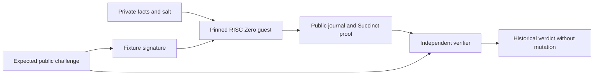

# RISC Zero stack: security, confidentiality and performance

Documentation status: October 15, 2026. Scope: the `labs/risc0` laboratory,
separate from the simulated MCP gateway. Execution results and reproducible
commands are recorded in [the testbed report](08-RISC0-LAB-RESULTS.md).
The presence of a control in code is not a test result.

## 1. Decision and usage limitation

The laboratory selects **RISC Zero 3.0.6, recursive `Succinct` STARK proofs,
local CPU generation and separate verification without the witness**.
This decision enables testing the shared business relation in a real zkVM
and measuring its cost. It qualifies neither a critical platform nor the
confidentiality of real secrets. [Release 3.0.6](https://github.com/risc0/risc0/releases/tag/v3.0.6)
is a published version; choosing an exact version facilitates reproduction
without constituting security certification.

The pilot uses fixtures exclusively. Its Ed25519 authority has a public key
fixed in the guest **and a published private test seed** in the runner
(`[7; 32]`). Any reader can therefore sign these fixtures. The test demonstrates
the verification mechanism in the guest; it provides no Jira, SonarQube,
GitLab or supplier authenticity.

The laboratory verifier performs **historical verification**: a valid proof
of a decision at the date bound to the challenge. It has no authorization
clock, durable nonce reservation, credentials or mutation function.
Its success alone does not permit a merge or deployment.

## 2. Relation actually computed

The `labs/risc0/methods/guest` guest calls `lab-statement`, which reuses
`crates/policy-statement` and `crates/policy-engine-core`. Business logic and
commitments are thus shared with native evaluation. The guest and core are
declared `no_std`; serialization and the journal use `alloc`.



Computation inside the guest follows these steps:

1. Read an input bounded at 16,384 bytes and deserialize `SignedRequest`.
2. Strictly verify the Ed25519 signature using the key fixed in the guest.
   The signed message is the domain-separated canonical digest of **the entire
   public challenge**, domain `zk-mcp/lab-source-attestation/v1`.
3. Recompute the commitment to the facts and salt, and the policy commitment.
   Compare them with the challenge values. The signature therefore binds facts
   indirectly through their complete commitment; it does not merely sign a
   “compliant” boolean.
4. Check bounds and format, then evaluate rules at `issued_at_ms` and against
   the revision bound to the challenge. The guest does not read actual time.
5. Publish the canonical journal: version, backend, profile, declared ELF digest,
   public-input hash, decision and date bound to the challenge.

Public inputs cover audience, tenant, tool, project, MR, SHA, policy,
commitments, nonce and expiration. Detailed facts and salt are not written to
the journal. However, it discloses the decision and violation codes; these
outputs are public information in the profile, not secrets protected by the proof.

Independent verification must receive the challenge retained by the verifier,
never a replacement challenge extracted from the proof. The testbed exports
this file from its runner for reproducibility: this does not simulate
independent issuance by a production customer.

## 3. Trust boundaries

| Component | Guarantee sought in the laboratory | Remaining limitation |
| --- | --- | --- |
| Business guest | Signature, commitments, bounds and rules executed in the expected image | A specification bug can be executed and proved correctly |
| Fixture authority | Ed25519 path verified inside the guest | Public signing secret; no supplier provenance |
| Local prover | Provides a verifiable receipt | Sees the witness; machine, memory and files must remain trusted for confidentiality |
| Verifier | Checks the complete proof, image, journal and expected challenge | Its binary and configuration are a root of trust |
| Clock and freshness | Dates cryptographically bound to the challenge | Current time, revocation and freshness at dispatch remain outside the proof |
| Nonce and operation state | Fields bound in the relation | Uniqueness, concurrency, restart and recovery require external transactional storage |
| Target API | No call in this testbed | Preconditions, actual effect and ambiguous result are not proved |

A supplier–customer extension will need to replace the public test authority
with a customer-administered trust registry. Verification of multiple independent
attestations, their common subject, signature chain and freshness is not
demonstrated by this single fixture. A signed collector attests to what it
claims to have observed; it does not turn declarative data into truth about
a platform.

The agent chooses neither the accepted guest, the trust key nor the expected
challenge. A compromised agent may then cause denials or denial of service;
it must not gain a mutation path that bypasses the verifier. This last property
requires gateway and target tests, separate from this side-effect-free laboratory.

## 4. Proof formats and verification

| RISC Zero format | Documented characteristic | Testbed decision |
| --- | --- | --- |
| `Composite` / `fast()` | Segment proofs; size tied to execution; recursive compression possible | Rejected on import; useful only as a separate future comparison |
| `Succinct` | Recursive compression; proof-format size independent of execution length | Only accepted format |
| `Groth16` | Compact proof suited to blockchain verifiers; generation requires Docker | Not used; adds SNARK assumptions and its setup |

These characteristics come from the [`ProverOpts` 3.0.6 API](https://docs.rs/risc0-zkvm/3.0.6/risc0_zkvm/struct.ProverOpts.html).
Proof size independent of duration does not mean that the whole bundle,
its journal or transport metadata has constant size.

The verifier pins two distinct identities:

- `POLICY_PROOF_GUEST_ID`, the native RISC Zero image used by
  `receipt.verify_with_context(...)`;
- the SHA-256 of the embedded ELF file, compared with the journal's
  `elf_image_id` field.

The ELF digest supplied as input to the guest is not an identity that the
guest proves about itself. The combination of the verified native image and
comparison with the ELF digest known to the verifier binds it to the accepted
profile.

The `verify_with_context` method checks, among other things, the expected
image, journal and successful termination. `verify_integrity` alone does not
replace this image and outcome check. Free-form receipt metadata is not an
authority for selecting a version. See the
[3.0.6 receipt code](https://raw.githubusercontent.com/risc0/risc0/v3.0.6/risc0/zkvm/src/receipt.rs).

Local import enforces the `zk-agentik-risc0-lab/1` format, a bundle of at most
2 MiB, a journal of at most 4,096 bytes, canonical Base64 and bounded
deserialization of the concrete `SuccinctReceipt<ReceiptClaim>` type.
It does not accept a polymorphic `Receipt` whose sender could choose the
`Fake` or `Composite` variant. These bounds reduce the input surface;
they do not replace parser fuzzing and memory-consumption tests.

### Development mode prohibited

The host/verifier workspace compiles `risc0-zkvm` with `disable-dev-mode` and
`default-features = false`. Prover options and verifier context also set
`with_dev_mode(false)`. The process rejects activation of `RISC0_DEV_MODE`.
A fake proof is an explicit negative input in the testbed.
The [upstream code for this option](https://raw.githubusercontent.com/risc0/risc0/v3.0.6/risc0/zkvm/src/lib.rs)
documents compile-time disabling.

This Cargo option does not retroactively recompile the installed external
`r0vm` binary. The acceptance boundary remains the verifier compiled with
the prohibition and the enforced `Succinct` format. Changing the environment
or replacing the prover must never suffice to get a simulated receipt accepted.

## 5. Confidentiality and security advisories

The official model distinguishes computation integrity from confidentiality.
It claims security budgets of 96 bits for the RISC-V component and 99 bits
for recursion under its cryptographic assumptions; these values do not add
up. It also states that a mathematical proof of the ZK property is not provided.
Nonrecursive RISC-V traces expose execution-length information; according to
the authors, recursion addresses this point. See the
[official security model](https://dev.risczero.com/api/security-model).

[Advisory GHSA-5xgj-pmjj-gw49](https://github.com/risc0/risc0/security/advisories/GHSA-5xgj-pmjj-gw49),
published July 15, 2024 and consulted October 15, 2026, still lists all versions
as affected and no patched version. It explains the limitation of confidentiality
arguments for certain STARK implementations; the authors report no known attack
exploiting this weakness.
**This laboratory therefore cannot justify a promise of mathematically
established confidentiality for critical secrets.** Not sending the witness
to the verifier is an observable interface property, with a narrower scope.

The proof does not eliminate possible leaks through the journal, repeated
queries, durations, cycle profiles or prover artifacts.
Local execution avoids entrusting the witness to a remote proving service;
it does not protect the witness from the host administrator.

The [CVE-2025-61588 / `sys_read` advisory](https://github.com/risc0/risc0/security/advisories/GHSA-jqq4-c7wq-36h7)
of October 1, 2025 concerns possible guest corruption by the host.
Fixes are announced for `risc0-zkvm` 2.3.2 / 3.0.3 and
`risc0-zkvm-platform` 2.1.0. The guest must be rebuilt and its authorized
image renewed; updating only the prover does not fix an old ELF.
For the 3.0.6 testbed, also check the dependencies actually resolved:

```sh
cargo tree --depth 0 -p risc0-zkvm-platform --manifest-path labs/risc0/methods/guest/Cargo.toml
```

Pinning 3.0.6 does not mean “no known or future defect”. Lockfiles, the rebuilt
guest, image identities and advisory review must be renewed together during
an update. This document is not an exhaustive dependency audit.

Finally, this stack is not entirely post-quantum: the authority uses Ed25519.
Choosing a SHA-256 commitment or a STARK proof does not change the nature of
that signature. The Groth16 profile would add further different assumptions;
it is not included in the testbed's decision.

## 6. Cryptographic patches and local environment

The guest manifest pins the following RISC Zero forks without reimplementing
primitives:

| Guest crate | Pinned revision | Provenance check |
| --- | --- | --- |
| `sha2` 0.10.9 | `8631fabdea7bdffa97b11868e04e73491d8e5bcf` | [RISC Zero backend selection for `riscv32`/`zkvm`](https://raw.githubusercontent.com/risc0/RustCrypto-hashes/8631fabdea7bdffa97b11868e04e73491d8e5bcf/sha2/src/sha256.rs) |
| `curve25519-dalek` 4.1.3 | `385adda1fa3b66d9aaa8b8fcc99ddc324d33ba32` | [RISC Zero accelerator integration commit](https://github.com/risc0/curve25519-dalek/commit/385adda1fa3b66d9aaa8b8fcc99ddc324d33ba32) |
| `crypto-bigint` 0.5.5 | `3ab63a6f1048833f7047d5a50532e4a4cc789384` | [Official fork required by the accelerated dalek backend](https://github.com/risc0/RustCrypto-crypto-bigint/commit/3ab63a6f1048833f7047d5a50532e4a4cc789384) |

The [RISC Zero precompiles documentation](https://dev.risczero.com/api/zkvm/precompiles)
requires checking their resolution in the guest's `Cargo.lock` and provides
`RISC0_INFO=1` to observe their use. It warns that these paths do not guarantee
constant execution or proving time. A declared patch is not itself a speedup
measurement; its benefit must be measured against the same guest and inputs
without that patch.

Target testbed configuration: Linux x86-64 container on Windows, limited to
8 CPU and 12 GiB, CPU proof generation. These limits are neither the maximum
RAM observed nor a guarantee that every policy fits this budget.
The [local proving documentation](https://dev.risczero.com/api/generating-proofs/local-proving)
describes CPU support and segment settings; no GPU is required for this profile.

The host explicitly constructs `ExternalProver::new` with the local path:

```text
/root/.risc0/extensions/v3.0.6-cargo-risczero-x86_64-unknown-linux-gnu/r0vm
```

It uses neither `default_prover` nor Bonsai selection. The absolute path avoids
accidental selection through `PATH`; it does not replace provenance and digest
verification of the installed binary. The code sets `segment_limit_po2(20)`
and a session limit of 16,000,000 cycles. Actual guest-tool, `r0vm`, lockfile
and container versions must accompany the results.

## 7. Measurements and falsifiable criteria

The runner distinguishes proof generation, verification, tampered-seal rejection
and signed native evaluation. Generation includes launching the local subprocess;
it does not include network, collection or an API call. Seal size, journal size
and serialized bundle size are three different measurements.

The runner defaults to three proofs and allows one to twenty samples.
The `p95_ms` field of this small series is an **exploratory empirical quantile**,
often its maximum; it is not a reliable estimate of a service p95.
The report must publish all these durations in order, the sample count and
distinguish the initial launch from subsequent ones. The current convention
selects, after sorting, the zero-based index `min(floor(0.95 * n), n - 1)`.

Verification and seal rejection are repeated 100 times after warmup.
This experiment on the same proof characterizes local warm cost.
It does not represent the diversity of adversarial inputs, machines or
concurrent load. A defensible service p95 requires a separate campaign,
representative sampling, a published quantile convention and statistical
uncertainty; increasing identical repetitions is insufficient.

| Hypothesis to test | Experiment that can falsify it | Rejection condition |
| --- | --- | --- |
| Proved computation matches shared computation | Compare native/guest journals for base, critical and denied profiles | Any divergence |
| The guest authenticates and binds its inputs | Alter signature, facts, commitment, policy or context separately | Acceptance of an input whose relation must fail |
| The verifier checks the complete proof | Change a bit in the middle of a correctly framed seal, without an earlier schema error | Acceptance, even occasionally |
| Image and challenge are fixed by the verifier | Wrong image, changed journal, different tenant/project/revision or nonce | Positive verdict for the wrong statement |
| Simulation mode cannot pass | `Fake` receipt, dev mode activation, unaccepted proof type | Any acceptance path |
| A valid proof can carry a policy denial | Prove the `denied` scenario, verify its proof, then request historical authorization | Authorization of the denied decision |
| The verifier is usable without the witness | Run the separate binary with only the proof and expected public challenge | Required reading of private facts, salt or a prover file |
| The target remains protected in future integration | Tampering, expiration, concurrent replay, crash and ambiguous API result with external counter | Unauthorized mutation or reuse of a consumed operation |
| The local budget is suitable | Measure cycles, time, peak memory and OOM under the stated limits | Exceeding the budget decided for the pilot |

Signature and witness mutations in the runner are checked by running the
guest with `execute`. They do not alone constitute a campaign of adversarial
proofs. The target test row remains an integration obligation: no mutation
counter can be presented as tested by this testbed without dispatch.

The “rejection under 5 ms” target must concern a named input class and scope.
Rejecting an expiration or invalid JSON under that threshold does not
demonstrate cryptographic verification of a forged seal under the same threshold.
If the complete measurement exceeds the target, retain fail-closed rejection
and revise the expected latency or architecture.

### 30-second TTL and proof before mutation

Fixtures may use a 30-second challenge lifetime. The historical testbed does
not check this lifetime against the time of verification.
The following must be measured separately:

```text
collection + queue wait + generation + transport + verification
+ freshness checks + durable reservation + API preconditions < TTL
```

If generation alone exceeds the TTL, the synchronous variant is invalidated
on this configuration. Successful historical verification does not bypass
this conclusion and must never become late authorization.

One direction to evaluate is precomputing the proof of an immutable artifact
state, then building a final proof that binds it to the customer challenge
issued later. The binding of the subject, policy, authority and commitments
would need to be explicitly proved, followed by handling freshness and
revocation. This composition is not implemented here; merely changing the
nonce of an existing proof is invalid. **The complete final proof remains
verified before any mutation**, even if part of the computation was done
in advance.

## 8. Results and decision to proceed

This document contains no invented performance measurements.
The [RISC Zero execution report](08-RISC0-LAB-RESULTS.md) must list commands,
versions, resources, proofs produced, verification in a separate process and
sampling limitations. A successful build alone does not validate proved execution.

Proceeding is justified for a **feasibility pilot using synthetic data** if
complete proofs are actually produced and verified, denials observed and
costs compatible with the selected scenario. Use requiring critical
confidentiality remains outside the validated scope until the documented
cryptographic objection, real source provenance and durable authorization
boundary are resolved.
