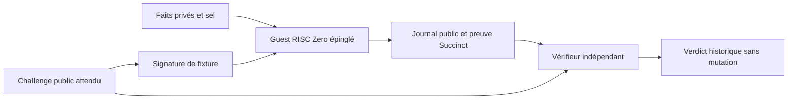

# Pile RISC Zero : sécurité, confidentialité et performance

État documentaire : 15 octobre 2026. Périmètre : laboratoire `labs/risc0`,
séparé du gateway MCP en simulation. Les résultats d'exécution et les commandes
reproductibles sont consignés dans [le rapport du banc](08-RISC0-LAB-RESULTS.md).
La présence d'un contrôle dans le code n'est pas un résultat de test.

## 1. Décision et limite d'emploi

Le laboratoire retient **RISC Zero 3.0.6, preuve STARK récursive `Succinct`,
génération CPU locale et vérification séparée sans witness**. Cette décision
permet de tester la relation métier partagée dans une vraie zkVM et de mesurer
son coût. Elle n'homologue ni une plateforme critique ni la confidentialité de
secrets réels. La [release 3.0.6](https://github.com/risc0/risc0/releases/tag/v3.0.6)
est une version publiée ; le choix d'une version exacte facilite la
reproduction, sans constituer une certification de sécurité.

Le pilote utilise exclusivement des fixtures. Son autorité Ed25519 possède
une clé publique fixée dans le guest **et une graine privée de test publiée**
dans le runner (`[7; 32]`). Tout lecteur peut donc signer ces fixtures. Le test
démontre le mécanisme de vérification dans le guest ; il ne fournit aucune
authenticité Jira, SonarQube, GitLab ou fournisseur.

Le vérifieur du laboratoire réalise une **vérification historique** : une
preuve valide d'une décision à la date liée au challenge. Il n'a ni horloge
d'autorisation, ni réserve durable de nonce, ni credentials, ni fonction de
mutation. Son succès ne permet pas à lui seul un merge ou un déploiement.

## 2. Relation effectivement calculée

Le guest `labs/risc0/methods/guest` appelle `lab-statement`, qui réutilise
`crates/policy-statement` et `crates/policy-engine-core`. La logique métier et
les engagements sont ainsi partagés avec l'évaluation native. Le guest et le
cœur sont déclarés `no_std` ; sérialisation et journal utilisent `alloc`.



Le calcul dans le guest suit ces étapes :

1. Lire une entrée bornée à 16 384 octets et désérialiser `SignedRequest`.
2. Vérifier strictement la signature Ed25519 avec la clé fixée dans le guest.
   Le message signé est le digest canonique séparé par domaine de **tout le
   challenge public**, domaine `zk-mcp/lab-source-attestation/v1`.
3. Recalculer l'engagement des faits et du sel, ainsi que celui de la politique.
   Les comparer aux valeurs du challenge. La signature lie donc les faits
   indirectement, par leur engagement complet ; elle ne signe pas seulement
   un booléen « conforme ».
4. Vérifier bornes et format, puis évaluer les règles à `issued_at_ms` et sur
   la révision liée au challenge. Le guest ne lit pas l'heure réelle.
5. Publier le journal canonique : version, backend, profil, digest ELF déclaré,
   hash des entrées publiques, décision et date liée au challenge.

Les entrées publiques couvrent audience, tenant, outil, projet, MR, SHA,
politique, engagements, nonce et expiration. Les faits détaillés et le sel ne
sont pas écrits dans le journal. Celui-ci divulgue cependant la décision et
les codes de violation ; ces sorties sont des informations publiques du
profil, pas des secrets protégés par la preuve.

La vérification indépendante doit recevoir le challenge conservé par le
vérifieur, jamais un challenge de remplacement extrait de la preuve. Le banc
exporte ce fichier depuis son runner pour la reproductibilité : cela ne
simule pas une émission indépendante par un client de production.

## 3. Frontières de confiance

| Élément | Garantie recherchée dans le laboratoire | Limite restante |
| --- | --- | --- |
| Guest métier | Signature, engagements, bornes et règles exécutés dans l'image attendue | Un bug de spécification peut être exécuté et prouvé correctement |
| Autorité de fixture | Chemin Ed25519 vérifié dans le guest | Secret de signature public ; aucune provenance fournisseur |
| Prover local | Fournit un receipt vérifiable | Voit le witness ; machine, mémoire et fichiers doivent rester de confiance pour la confidentialité |
| Vérifieur | Contrôle la preuve complète, l'image, le journal et le challenge attendu | Son binaire et sa configuration constituent une racine de confiance |
| Horloge et fraîcheur | Dates liées cryptographiquement au challenge | L'heure présente, la révocation et la fraîcheur au dispatch restent hors preuve |
| Nonce et état d'opération | Champs liés dans la relation | Unicité, concurrence, redémarrage et reprise exigent un stockage transactionnel externe |
| API cible | Aucun appel dans ce banc | Préconditions, effet réel et résultat ambigu ne sont pas prouvés |

Une extension fournisseur-client devra remplacer l'autorité publique de test
par un registre de confiance administré côté client. La vérification de
plusieurs attestations indépendantes, de leur objet commun, de leur chaîne de
signature et de leur fraîcheur n'est pas démontrée par cette fixture unique.
Un collecteur signé atteste ce qu'il affirme avoir observé ; il ne transforme
pas des données déclaratives en vérité sur une plateforme.

L'agent ne choisit ni le guest accepté, ni la clé de confiance, ni le challenge
attendu. La compromission d'un agent peut alors provoquer des refus ou un déni
de service ; elle ne doit pas lui donner un chemin de mutation contournant le
vérifieur. Cette dernière propriété exige les tests du gateway et de la cible,
distincts de ce laboratoire sans effets de bord.

## 4. Formats de preuve et vérification

| Format RISC Zero | Caractéristique documentée | Décision du banc |
| --- | --- | --- |
| `Composite` / `fast()` | Preuves de segments ; taille liée à l'exécution ; compression récursive possible | Refus à l'import ; utile seulement comme comparaison future séparée |
| `Succinct` | Compression récursive ; taille indépendante de la longueur d'exécution pour le format de preuve | Seul format accepté |
| `Groth16` | Preuve compacte adaptée aux vérifieurs de blockchain ; génération requérant Docker | Non utilisé ; ajoute les hypothèses du SNARK et son setup |

Ces caractéristiques viennent de l'[API `ProverOpts` 3.0.6](https://docs.rs/risc0-zkvm/3.0.6/risc0_zkvm/struct.ProverOpts.html).
Une taille de preuve indépendante de la durée ne signifie pas que tout le
bundle, son journal ou les métadonnées de transport ont une taille constante.

Le vérifieur épingle deux identités distinctes :

- `POLICY_PROOF_GUEST_ID`, l'image native RISC Zero utilisée par
  `receipt.verify_with_context(...)` ;
- le SHA-256 du fichier ELF intégré, comparé au champ `elf_image_id` du journal.

Le digest ELF fourni en entrée au guest n'est pas une identité que le guest
se prouve lui-même. C'est la combinaison de l'image native vérifiée et de la
comparaison au digest ELF connu du vérifieur qui le lie au profil accepté.

La méthode `verify_with_context` vérifie notamment l'image attendue, le
journal et une terminaison réussie. `verify_integrity` seule ne remplace pas
ce contrôle d'image et de résultat. Les métadonnées libres d'un receipt ne
sont pas une autorité de sélection de version. Voir le
[code du receipt 3.0.6](https://raw.githubusercontent.com/risc0/risc0/v3.0.6/risc0/zkvm/src/receipt.rs).

L'import local impose le format `zk-agentik-risc0-lab/1`, un bundle de 2 MiB
au plus, un journal de 4 096 octets au plus, du Base64 canonique et une
désérialisation bornée du type concret `SuccinctReceipt<ReceiptClaim>`.
Il n'accepte pas un `Receipt` polymorphe dont l'émetteur choisirait la variante
`Fake` ou `Composite`. Ces bornes réduisent la surface d'entrée ; elles ne
remplacent pas un fuzzing du parseur et des essais de consommation mémoire.

### Mode développement interdit

Le workspace hôte/vérifieur compile `risc0-zkvm` avec `disable-dev-mode` et
`default-features = false`. Les options du prover et le contexte du vérifieur
fixent aussi `with_dev_mode(false)`. Le processus rejette une activation de
`RISC0_DEV_MODE`. Une fausse preuve est une entrée négative explicite du banc.
Le [code amont de cette option](https://raw.githubusercontent.com/risc0/risc0/v3.0.6/risc0/zkvm/src/lib.rs)
documente la désactivation à la compilation.

Cette option Cargo ne recompilie pas rétroactivement le binaire externe
`r0vm` installé. La frontière d'acceptation reste le vérifieur compilé avec
l'interdiction et le format `Succinct` imposé. Modifier l'environnement ou
remplacer le prover ne doit jamais suffire à faire accepter un receipt simulé.

## 5. Confidentialité et avis de sécurité

Le modèle officiel distingue intégrité du calcul et confidentialité. Il
annonce des budgets de sécurité de 96 bits pour le composant RISC-V et de
99 bits pour la récursion, sous ses hypothèses cryptographiques ; ces valeurs
ne s'additionnent pas. Il précise aussi qu'une preuve mathématique de la
propriété ZK n'est pas fournie. Les traces RISC-V non récursives exposent une
information de longueur d'exécution ; la récursion traite ce point selon les
auteurs. Voir le [modèle de sécurité officiel](https://dev.risczero.com/api/security-model).

L'[avis GHSA-5xgj-pmjj-gw49](https://github.com/risc0/risc0/security/advisories/GHSA-5xgj-pmjj-gw49),
publié le 15 juillet 2024 et consulté le 15 octobre 2026, indique encore toutes
versions affectées et aucune version corrigée. Il explique la limite des
arguments de confidentialité pour certaines implémentations STARK ; les
auteurs n'y rapportent pas d'attaque connue exploitant cette faiblesse.
**Ce laboratoire ne peut donc pas justifier une promesse de confidentialité
mathématiquement établie pour des secrets critiques.** Ne pas transmettre le
witness au vérifieur est une propriété d'interface observable, plus limitée.

La preuve n'efface pas les fuites possibles par le journal, des requêtes
répétées, les durées, les profils de cycles ou les artefacts du prover.
L'exécution locale évite de confier le witness à un service de preuve distant ;
elle ne protège pas ce witness contre l'administrateur de l'hôte.

L'[avis CVE-2025-61588 / `sys_read`](https://github.com/risc0/risc0/security/advisories/GHSA-jqq4-c7wq-36h7)
du 1er octobre 2025 concerne une possibilité de corruption du guest par
l'hôte. Les correctifs sont annoncés pour `risc0-zkvm` 2.3.2 / 3.0.3 et
`risc0-zkvm-platform` 2.1.0. Il faut reconstruire le guest et renouveler son
image autorisée ; mettre à jour le prover seul ne corrige pas un ancien ELF.
Pour le banc 3.0.6, contrôler également les dépendances réellement résolues :

```sh
cargo tree --depth 0 -p risc0-zkvm-platform --manifest-path labs/risc0/methods/guest/Cargo.toml
```

Le pin 3.0.6 ne signifie pas « aucun défaut connu ou futur ». Les lockfiles,
le guest reconstruit, les identités d'image et la revue des avis doivent être
renouvelés ensemble lors d'une mise à jour. Ce document ne constitue pas un
audit exhaustif des dépendances.

Enfin, cette pile n'est pas entièrement post-quantique : l'autorité utilise
Ed25519. Le choix d'un engagement SHA-256 ou d'une preuve STARK ne change pas
la nature de cette signature. Le profil Groth16 ajouterait encore des
hypothèses différentes ; il n'est pas inclus dans la décision du banc.

## 6. Patches cryptographiques et environnement local

Le manifeste du guest épingle les forks RISC Zero suivants, sans
réimplémenter les primitives :

| Crate du guest | Révision fixée | Vérification de provenance |
| --- | --- | --- |
| `sha2` 0.10.9 | `8631fabdea7bdffa97b11868e04e73491d8e5bcf` | [Sélection du backend RISC Zero pour `riscv32`/`zkvm`](https://raw.githubusercontent.com/risc0/RustCrypto-hashes/8631fabdea7bdffa97b11868e04e73491d8e5bcf/sha2/src/sha256.rs) |
| `curve25519-dalek` 4.1.3 | `385adda1fa3b66d9aaa8b8fcc99ddc324d33ba32` | [Commit d'intégration des accélérateurs RISC Zero](https://github.com/risc0/curve25519-dalek/commit/385adda1fa3b66d9aaa8b8fcc99ddc324d33ba32) |
| `crypto-bigint` 0.5.5 | `3ab63a6f1048833f7047d5a50532e4a4cc789384` | [Fork officiel nécessaire au backend dalek accéléré](https://github.com/risc0/RustCrypto-crypto-bigint/commit/3ab63a6f1048833f7047d5a50532e4a4cc789384) |

La documentation des [précompiles RISC Zero](https://dev.risczero.com/api/zkvm/precompiles)
demande de vérifier leur résolution dans le `Cargo.lock` du guest et fournit
`RISC0_INFO=1` pour observer leur utilisation. Elle prévient que ces chemins
ne garantissent pas un temps constant d'exécution ou de preuve. Un patch
déclaré n'est pas, à lui seul, une mesure d'accélération ; son gain doit être
mesuré contre le même guest et les mêmes entrées sans ce patch.

Configuration visée pour le banc : conteneur Linux x86-64 sous Windows,
limité à 8 CPU et 12 GiB, preuve CPU. Ces limites ne sont ni la RAM maximale
observée ni une garantie que toute politique tient dans ce budget. La
[documentation de preuve locale](https://dev.risczero.com/api/generating-proofs/local-proving)
décrit le support CPU et le réglage des segments ; aucun GPU n'est requis
pour ce profil.

L'hôte construit explicitement `ExternalProver::new` avec le chemin local :

```text
/root/.risc0/extensions/v3.0.6-cargo-risczero-x86_64-unknown-linux-gnu/r0vm
```

Il n'utilise pas `default_prover`, ni la sélection Bonsai. Le chemin absolu
évite une sélection accidentelle par le `PATH` ; il ne remplace pas la
vérification de provenance et de digest du binaire installé. Le code fixe
`segment_limit_po2(20)` et une limite de session de 16 000 000 cycles. Les
versions effectives de l'outil guest, de `r0vm`, des lockfiles et du conteneur
doivent accompagner les résultats.

## 7. Mesures et critères réfutables

Le runner distingue génération de preuve, vérification, rejet d'un seal
altéré et évaluation native signée. La génération inclut le lancement du
sous-processus local ; elle ne comprend pas le réseau, la collecte ou un
appel API. La taille du seal, celle du journal et celle du bundle sérialisé
sont trois mesures différentes.

Le runner utilise par défaut trois preuves et permet de un à vingt
échantillons. Le champ `p95_ms` de cette petite série est un **quantile
empirique exploratoire**, souvent son maximum ; ce n'est pas une estimation
fiable du p95 d'un service. Le rapport doit publier toutes ces durées dans
l'ordre, le nombre d'échantillons et distinguer lancement initial et suivants.
La convention actuelle sélectionne, après tri, l'indice zéro-basé
`min(floor(0.95 * n), n - 1)`.

La vérification et le rejet de seal sont répétés 100 fois après échauffement.
Cette expérience sur une même preuve renseigne le coût local à chaud. Elle
ne représente pas la diversité des entrées adverses, des machines ou de la
charge concurrente. Un p95 de service défendable exige une campagne séparée,
un échantillonnage représentatif, une convention de quantile publiée et une
incertitude statistique ; augmenter le nombre de répétitions identiques ne
suffit pas.

| Hypothèse à tester | Expérience qui peut la réfuter | Condition de rejet |
| --- | --- | --- |
| Le calcul prouvé correspond au calcul partagé | Comparer journaux natif/guest pour les profils de base, critique et refusé | Toute divergence |
| Le guest authentifie et lie ses entrées | Altérer signature, faits, engagement, politique ou contexte séparément | Acceptation d'une entrée dont la relation doit échouer |
| Le vérifieur contrôle la preuve complète | Modifier un bit au milieu d'un seal correctement encadré, sans erreur de schéma préalable | Acceptation, même occasionnelle |
| L'image et le challenge sont fixés par le vérifieur | Mauvaise image, journal modifié, autre tenant/projet/révision ou nonce | Verdict positif pour le mauvais énoncé |
| Le mode simulé ne passe pas | Receipt `Fake`, activation du dev mode, type de preuve non accepté | Un chemin d'acceptation |
| Une preuve valide peut porter un refus métier | Prouver le scénario `denied`, vérifier sa preuve, puis demander l'autorisation historique | Autorisation de la décision refusée |
| Le vérifieur est utilisable sans witness | Exécuter le binaire séparé avec seulement preuve et challenge public attendu | Lecture requise des faits privés, du sel ou d'un fichier du prover |
| La cible reste protégée en intégration future | Falsification, expiration, rejeu concurrent, crash et résultat API ambigu avec compteur externe | Mutation non autorisée ou réutilisation d'une opération consommée |
| Le budget local est adapté | Mesurer cycles, temps, mémoire maximale et OOM sous les limites annoncées | Dépassement du budget décidé pour le pilote |

Les mutations de signature et de witness présentes dans le runner sont
contrôlées par exécution du guest avec `execute`. Elles ne constituent pas
à elles seules une campagne de preuves adverses. La ligne de tests sur la
cible reste une obligation d'intégration : aucun compteur de mutation ne
peut être présenté comme testé par ce laboratoire sans dispatch.

L'objectif « rejet sous 5 ms » doit porter sur une classe d'entrée et un
périmètre nommés. Rejeter une expiration ou un JSON invalide sous ce seuil ne
démontre pas la vérification cryptographique d'un seal falsifié sous ce même
seuil. Si la mesure complète dépasse l'objectif, on conserve le refus fermé
et on révise la latence attendue ou l'architecture.

### TTL de 30 secondes et preuve avant mutation

Les fixtures peuvent utiliser une durée de challenge de 30 secondes. Le
banc historique ne contrôle pas cette durée contre l'heure de sa vérification.
Il faut mesurer séparément :

```text
collecte + attente en file + génération + transport + vérification
+ contrôles de fraîcheur + réservation durable + préconditions API < TTL
```

Si la génération seule dépasse le TTL, la variante synchrone est invalidée
sur cette configuration. Une vérification historique réussie ne contourne
pas cette conclusion et ne doit jamais devenir une autorisation tardive.

Une piste à évaluer consiste à précalculer la preuve d'un état d'artefact
immuable, puis à construire une preuve finale liant cette preuve au challenge
client émis plus tard. Il faudrait prouver explicitement la liaison de
l'objet, de la politique, de l'autorité et des engagements, puis traiter la
fraîcheur et la révocation. Cette composition n'est pas implémentée ici ;
modifier simplement le nonce d'une preuve existante est invalide. **La preuve
finale complète reste vérifiée avant toute mutation**, même si une partie du
calcul a été anticipée.

## 8. Résultats et décision de poursuite

Ce document ne contient aucune mesure de performance inventée. Le
[rapport d'exécution RISC Zero](08-RISC0-LAB-RESULTS.md) doit indiquer les
commandes, versions, ressources, preuves produites, vérification dans un
processus séparé et limites d'échantillonnage. Un build réussi seul ne valide
pas l'exécution prouvée.

La poursuite est justifiée pour un **pilote de faisabilité à données
synthétiques** si les preuves complètes sont effectivement produites et
vérifiées, les refus observés et les coûts compatibles avec le scénario
retenu. Une utilisation à confidentialité critique reste hors du périmètre
validé tant que l'objection cryptographique documentée, la provenance réelle
des sources et la frontière d'autorisation durable ne sont pas résolues.
