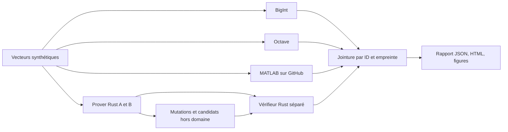

# Validation corrélée du circuit Horizon

Ce banc relie des données synthétiques identiques à quatre observations : calcul
BigInt, oracle Octave, prover Rust et vérifieur Rust dans un autre processus.
Un job MATLAB explicite ajoute une cinquième observation sur **les mêmes octets**.
La relation reste celle de `horizon-range-v1` ; aucun nouveau protocole n'est introduit.

```text
1 <= a <= 2^32  et  0 <= c-a < 2^32
X = A-G = (a-1)G + r_a H
D = C-A = (c-a)G + (r_c-r_a)H
```

La [démonstration LaTeX](../../whitepaper/circuit-validation.tex) explicite les
hypothèses de connaissance, de liaison et d'émission. L'oracle numérique ne
prouve pas la sécurité des primitives. Les signatures Ed25519 sont vérifiées
hors circuit ; le profil Bulletproofs/Ristretto n'est pas post-quantique.

## Exécuter et inspecter

Rust 1.93, Node 24.11 et Docker sont nécessaires. Les dépendances cryptographiques
restent verrouillées. Le Dockerfile fixe le digest Debian ; les paquets apt sont
enregistrés dans le rapport, sans promesse de reconstruction bit à bit.

```sh
npm ci --ignore-scripts
npm run test:circuit
npm run circuit:campaign -- --cases 4096 --output .tools/circuit-my-run --build
```

Tailles autorisées : **128, 1024, 4096**. Le répertoire doit être nouveau. Sans
`--build`, image et binaire doivent déjà exister. Les dates sont celles de
l'horloge locale, sans TSA. `OsRng` génère clés, ouvertures et aléas de preuve ;
seuls les montants du corpus sont reproductibles, pas les octets des preuves.

Ouvrir `.tools/circuit-my-run/public/report.html` : filtres par famille, cas
inspectables, graphique du domaine et distribution des durées réellement
observées. Les graphiques Matplotlib existent également en PNG et SVG.
Le rapport signale séparément MATLAB : le résultat Octave ne le remplace pas.
Pour le profil court intégré à l'outillage : `npm run proofkit -- run circuit`.

Le fichier `verification-requests.ndjson.gz` conserve **tout** le corpus public,
avec attestations et preuves, y compris les candidats invalides et mutations.
Les montants sont publics parce qu'ils sont synthétiques ; ni clés privées ni
ouvertures des engagements ne sont exportées. Les journaux locaux restent hors
du bundle. Aucune API de banque, assurance ou paiement n'est appelée.

Pour revérifier les reçus archivés, sans regénérer les preuves :

```sh
npm run horizon:build
node scripts/circuit-reverify.mjs <repertoire-public-archive> .tools/circuit-reverification-new
```

Le vérifieur utilise le même code Rust verrouillé dans un autre processus.
Il s'agit d'une vérification séparée du prover, pas d'une seconde implémentation
cryptographique indépendante. La confiance et l'horloge des requêtes sont celles
du banc synthétique : ce binaire ne doit pas être exposé comme serveur d'autorisation.

## Corrélation exigée

| Couche | Observation exigée | Contre-épreuve |
| --- | --- | --- |
| Domaine | Chaînes u64, bornes exactes et soustractions gardées | `0`, `2^32`, `2^33-1`, `2^53+1`, `u64::MAX`, hors plage |
| BigInt / Octave / MATLAB | Même verdict et mêmes différences décimales par ID | Entrées invalides, arrondi/saturation, cas supprimé ou substitué |
| Prover natif A/B | Même relation, mêmes motifs de refus | Contournement du preflight par l'API Bulletproofs amont |
| Vérifieur A/B | Accepte chaque preuve valide, refuse les candidats hors domaine | Corruption algébrique parseable et résignée, transplantation A |
| Contexte | Clés, signatures, politiques, dates et jointure des attestations | 14 familles de mutations par cas valide |
| Artefacts | Statuts complets, ensemble exact de lignes, compteurs, SHA-256 des vecteurs et du corpus décompressé | Fichier manquant, doublon, statut échoué, hash incohérent, compteur falsifié |

Chaque cas valide génère deux preuves (A et B) et 16 vérifications, dont deux
acceptations attendues. Chaque cas invalide génère deux **candidats invalides**
directement via la bibliothèque amont, puis deux vérifications devant échouer
à `INVALID_RANGE_PROOF`. Ces candidats ne sont pas comptés comme preuves valides.
La vérification ignore l'annotation `expected_accept` ; un test l'inverse pour
vérifier cette propriété. Une signature cassée ne peut pas tenir lieu de test
de rejet algébrique : le corrélateur impose l'étape de refus exacte.

Les candidats avec `a=0` ou `c<a` utilisent une soustraction `u64` avec retour
modulo `2^64` pour contourner le preflight : leurs engagements diffèrent aussi
des engagements dérivés attendus dans Ristretto. Leur rejet éprouve la relation
complète, pas uniquement un comparateur. Les cas `a>2^32` ou `c-a>=2^32` sans
sous-dépassement isolent mieux la contrainte de plage.

Le manifeste relie les fichiers, les sources, le binaire, la machine, les étapes
et leurs codes de sortie. Une empreinte ne démontre pas la vérité d'un rapport ;
la reproduction et la revérification sont nécessaires. Les résultats anciens
ne sont pas remplacés. Une exécution interrompue conserve un résultat d'échec.

## Mathématiques, agent et pipeline



Le [workflow réutilisable GitHub Actions](GITHUB_ACTIONS.md) exécute des commandes
revues et bornées. Il n'invente pas de circuit à partir d'un LLM. Le scénario
agentique MCP reste testé par `npm run test:horizon` et `npm run horizon:demo` :
proposition, challenge imposé, preuve réelle, contrôle, réservation et effet
synthétique. La campagne mathématique ne clôt pas H14 (cible distante) ou H15
(audit cryptographique externe).

Les durées de cette campagne sont des observations de tests sans échauffement
dédié ni protocole de performance isolé. Ni record Vega, ni accélération GPU,
ni probabilité de faux positif cryptographique ne s'en déduisent. Un bilan de
zéro acceptation indue concerne les essais exécutés, pas toutes les attaques.
