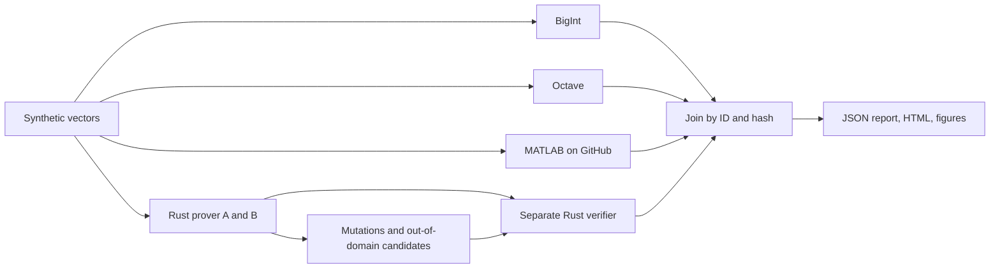

# Correlated Horizon circuit validation

This testbed connects identical synthetic data to four observations: BigInt
computation, Octave oracle, Rust prover and Rust verifier in another process.
An explicit MATLAB job adds a fifth observation on **the same bytes**.
The relation remains `horizon-range-v1`; no new protocol is introduced.

[Dated results and actual pipelines](RESULTS_2026-10-17.md) ·
[Interactive report](views/windows-e7fc348/report.html) ·
[Mathematical proof PDF](../../whitepaper/circuit-validation.pdf).

```text
1 <= a <= 2^32  and  0 <= c-a < 2^32
X = A-G = (a-1)G + r_a H
D = C-A = (c-a)G + (r_c-r_a)H
```

The [LaTeX proof](../../whitepaper/circuit-validation.tex) makes the knowledge,
binding and issuance assumptions explicit. The numerical oracle does not
prove the security of the primitives. Ed25519 signatures are verified outside
the circuit; the Bulletproofs/Ristretto profile is not post-quantum.

## Run and inspect

Rust 1.93, Node 24.11 and Docker are required. Cryptographic dependencies
remain locked. The Dockerfile pins the Debian digest; apt packages are recorded
in the report, with no promise of bit-for-bit reconstruction.

```sh
npm ci --ignore-scripts
npm run test:circuit
npm run circuit:campaign -- --cases 4096 --output .tools/circuit-my-run --build
```

Allowed sizes: **128, 1024, 4096**. The directory must be new. Without `--build`,
the image and binary must already exist. Dates come from the local clock,
without a TSA. `OsRng` generates keys, openings and proof randomness;
only corpus amounts are reproducible, not proof bytes.

Open `.tools/circuit-my-run/public/report.html`: family filters, inspectable
cases, domain plot and distribution of actually observed durations.
Matplotlib plots are also available as PNG and SVG. The report flags MATLAB
separately: the Octave result does not replace it. For the short profile
integrated into the tooling: `npm run proofkit -- run circuit`.

The `verification-requests.ndjson.gz` file retains the **entire** public corpus,
with attestations and proofs, including invalid candidates and mutations.
Amounts are public because they are synthetic; neither private keys nor
commitment openings are exported. Local logs stay outside the bundle.
No banking, insurance or payment API is called.

To reverify archived receipts without regenerating proofs:

```sh
npm run horizon:build
node scripts/circuit-reverify.mjs <archived-public-directory> .tools/circuit-reverification-new
```

The verifier uses the same locked Rust code in another process.
This is verification separate from the prover, not a second independent
cryptographic implementation. Request trust and clock values belong to the
synthetic testbed: this binary must not be exposed as an authorization server.

## Required correlation

| Layer | Required observation | Negative test |
| --- | --- | --- |
| Domain | u64 strings, exact bounds and guarded subtractions | `0`, `2^32`, `2^33-1`, `2^53+1`, `u64::MAX`, out of range |
| BigInt / Octave / MATLAB | Same verdict and same decimal differences per ID | Invalid inputs, rounding/saturation, removed or substituted case |
| Native prover A/B | Same relation, same denial reasons | Preflight bypass through the upstream Bulletproofs API |
| Verifier A/B | Accepts every valid proof, rejects out-of-domain candidates | Parseable and re-signed algebraic corruption, A transplantation |
| Context | Keys, signatures, policies, dates and attestation join | 14 mutation families per valid case |
| Artifacts | Complete statuses, exact row set, counters, SHA-256 of vectors and decompressed corpus | Missing file, duplicate, failed status, inconsistent hash, falsified counter |

Each valid case generates two proofs (A and B) and 16 verifications, including
two expected acceptances. Each invalid case generates two **invalid candidates**
directly through the upstream library, followed by two verifications that must
fail with `INVALID_RANGE_PROOF`. These candidates are not counted as valid
proofs. Verification ignores the `expected_accept` annotation; a test reverses
it to check this property. A broken signature cannot substitute for an
algebraic rejection test: the correlator enforces the exact rejection stage.

Candidates with `a=0` or `c<a` use `u64` subtraction wrapping modulo `2^64`
to bypass preflight: their commitments also differ from the expected derived
commitments in Ristretto. Their rejection tests the complete relation, not
just a comparator. Cases with `a>2^32` or `c-a>=2^32` without underflow
better isolate the range constraint.

The manifest links files, sources, binary, machine, steps and their exit codes.
A hash does not establish the truth of a report; reproduction and reverification
are necessary. Old results are not replaced. An interrupted run retains a
failure result.

## Mathematics, agent and pipeline



The [reusable GitHub Actions workflow](GITHUB_ACTIONS.md) runs reviewed,
bounded commands. It does not invent a circuit from an LLM. The MCP agentic
scenario remains tested by `npm run test:horizon` and `npm run horizon:demo`:
proposal, enforced challenge, real proof, control, reservation and synthetic
effect. The mathematical campaign does not close H14 (remote target) or H15
(external cryptographic audit).

This campaign's durations are test observations without dedicated warmup
or an isolated performance protocol. They imply neither a Vega record,
GPU speedup nor a cryptographic false-positive probability.
Zero observed improper acceptances concerns the tests executed, not all attacks.
