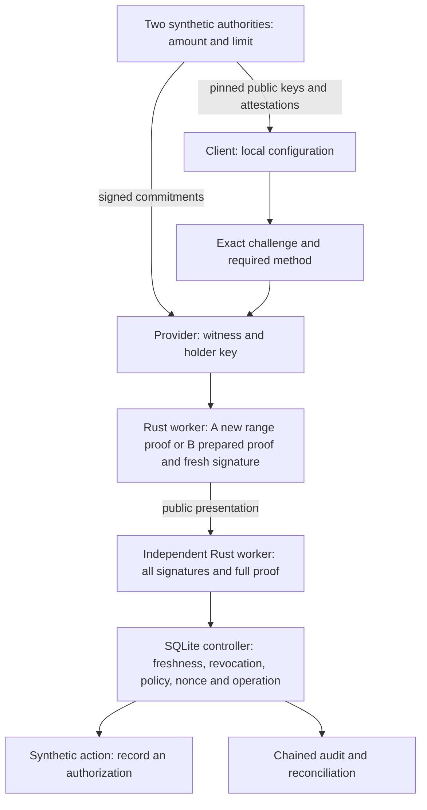

# Horizon laboratory architecture



## Implementation

`labs/horizon/proof` is a Rust library and two binaries independent of the
historical workspace. `horizon-proof-worker` receives one JSON request per line;
`horizon-benchmark` measures internal functions. Primitives are provided by
Bulletproofs 5 and Dalek, with pinned versions. Proof logic is not reimplemented
in TypeScript. The historical `no_std` Rust engine and the RISC Zero lab remain
unchanged and address a different relation.

`packages/horizon-demo` contains a strictly typed HTTP API and a static interface.
The provider holds only its private configuration and its worker. The client
holds only its public configuration, a separate worker and its database.
Selection C is enforced by local policy; A, B and the non-ZK baseline remain
distinguishable. No strategy claims to be new.

The historical MCP SDK remains separate. The October 17 Proofkit addition
centralizes the Horizon HTTP/MCP path in `defineVerifiedTool` and the adapter
`packages/horizon-demo/src/tool.ts`. The official MCP transport exposes only
challenge issuance and presentation submission; it carries neither prover
secrets nor administration routes. The Bulletproofs proof is verified by the
same worker before the same SQLite controller. No `_meta.zkp` field from the
historical protocol is reinterpreted as this new profile. The host, its adapters
and its configuration are trusted. This integration does not resolve real
issuance, contractual rules or banking IAM. Measurements predating the SDK do
not measure its transport.

Operational HTTP routes check a separate operator secret, absent from the
browser and MCP tools. Without explicit configuration, revocation, policy
rotation and reconciliation are denied. This local control provides neither
banking identity nor individually assigned roles. It never replaces proof
verification in the authorization flow. The [deployment guide](DEPLOYMENT.md)
describes this boundary and the relay's limitations.

In Compose, an HTTP relay with no secrets publishes both loopback ports. Its
destinations and routes are constant. Only this relay joins both the ingress
network and the internal network; no prover/verifier port is published directly.
It never retries a forwarded POST with an unknown outcome. This adaptation makes
the sandbox accessible on Docker Desktop without providing an Internet route
to processes holding private data or action state.

## Durable state and effects

The first transaction consumes the nonce and reserves the operation, then
commits. The second rechecks time bounds and current state, and writes the
simulated action and its audit record. Business identity depends on tenant,
audience, action and case; changing the nonce or policy does not recreate an action.

```text
absent -> RESERVED -> COMPLETED
                  -> REJECTED
                  -> UNKNOWN -> reconciliation -> COMPLETED, REJECTED or UNKNOWN
```

A shutdown after reservation never releases the operation. With the local
target, reconciliation reads the local effects table without redispatching and
`UNKNOWN` stays `UNKNOWN` when no effect is found. The ambiguity test forces
`UNKNOWN` after a known effect at the synthetic target.

Since 25 October 2026 (H14) the verifier can dispatch to a **separate durable
sandbox target** process ([details](REMOTE_TARGET_2026-10-25.md)): the object
version is read before reservation and stored with it, the deadline is
rechecked after reservation with no await before the single mutation attempt,
the attempt carries the authorization deadline (refused by the target clock
after it), and every transport ambiguity stays `UNKNOWN`. The reservation
records which target it was dispatched to; reconciliation addresses that target
only and never rewrites a terminal state. Reconciliation *fences* the operation
at the target: an existing record with our bundle hash is
`COMPLETED`, a fence or another writer's record is `REJECTED`, an unreachable
target leaves `UNKNOWN`. No path redispatches. This sandbox contract
(idempotency key, exact precondition, status route, fence) is what a remote
banking API would have to offer; none is assumed to.

Events are chained with SHA-256. This detects tampering when a trusted earlier
head is available; an administrator can rewrite the entire chain. No external
anchoring/WORM storage or regulatory vault is provided.

## Trust boundaries and migration

An instance configures one tenant and one case. Tests reject a different
configuration on the same database. They do not qualify large-scale SaaS
isolation. A policy/registry migration must be operated on both client and
provider sides; the prototype revokes/increments epochs to demonstrate rejection,
without automatic reissuance that could reauthorize a consumed operation.

The profile, signature domains, strict types and pinned dependencies identify
the version. A future cryptographic suite must have a new identifier, new
approved roots and cross-rejection tests; there is no automatic fallback to
disclosure or to the simulator.
