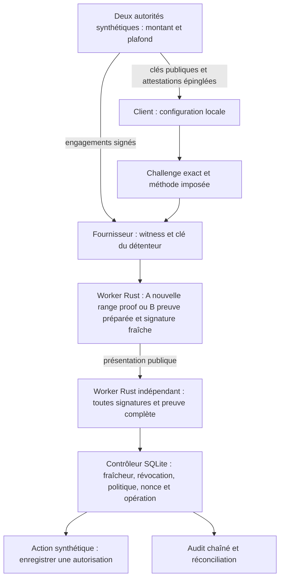

# Architecture du laboratoire Horizon



## Implémentation

`labs/horizon/proof` est une bibliothèque Rust et deux binaires indépendants du
workspace historique. `horizon-proof-worker` reçoit une requête JSON par ligne ;
`horizon-benchmark` mesure les fonctions internes. Les primitives sont fournies
par Bulletproofs 5 et Dalek, versions figées. La logique de preuve n'est pas
réimplémentée en TypeScript. Le moteur Rust historique `no_std` et le lab RISC
Zero restent intacts et répondent à une autre relation.

`packages/horizon-demo` contient une API HTTP typée stricte et une interface
statique. Le fournisseur possède uniquement sa configuration privée et son
worker. Le client possède uniquement sa configuration publique, un autre worker
et sa base. La sélection C est imposée par la politique locale ; A, B et la
baseline non-ZK restent identifiables. Aucune stratégie ne prétend être nouvelle.

Le SDK MCP historique reste distinct. L'ajout Proofkit du 17 octobre centralise
le chemin HTTP/MCP Horizon dans `defineVerifiedTool` et l'adaptateur
`packages/horizon-demo/src/tool.ts`. Le transport MCP officiel expose seulement
émission de challenge et soumission d'une présentation ; il ne porte pas les
secrets du prover ni les routes d'administration. La preuve Bulletproofs est
vérifiée par le même worker avant le même contrôleur SQLite. Aucun champ
`_meta.zkp` du protocole historique n'est réinterprété comme ce nouveau profil.
L'hôte, ses adaptateurs et sa configuration sont de confiance. Cette intégration
ne résout pas l'émission réelle, les règles contractuelles ou l'IAM bancaire.
Les mesures antérieures au SDK ne constituent pas une mesure de son transport.

Les routes HTTP d'exploitation vérifient un secret opérateur distinct, absent
du navigateur et des outils MCP. Sans configuration explicite, révocation,
rotation de politique et réconciliation sont refusées. Ce contrôle local ne
fournit ni identité bancaire ni rôles nominatifs. Il ne remplace jamais la
vérification de preuve du parcours d'autorisation. Le [guide de déploiement](DEPLOYMENT.md)
précise cette frontière et les limites du relais.

Dans Compose, un relais HTTP sans secret publie les deux ports loopback. Ses
destinations et routes sont constantes. Lui seul joint le réseau d'entrée et
le réseau interne ; aucun port du prover/vérifieur n'est directement publié.
Il ne réessaie jamais un POST transmis dont le résultat est inconnu. Cette
adaptation rend le sandbox accessible sur Docker Desktop sans fournir de
route Internet aux processus portant les données privées ou l'état d'action.

## État durable et effets

La première transaction consomme le nonce et réserve l'opération, puis commit.
La seconde revérifie les bornes temporelles et l'état courant, écrit l'action
simulée et son audit. L'identité métier dépend de tenant, audience, action et
dossier ; un changement de nonce ou politique ne recrée pas une action.

```text
absent -> RESERVED -> COMPLETED
                  -> REJECTED
                  -> UNKNOWN -> réconciliation -> COMPLETED ou UNKNOWN
```

Un arrêt après réservation ne relâche jamais l'opération. La réconciliation
lit la cible locale, sans redispatch. Le test d'ambiguïté force `UNKNOWN` après
un effet connu de la cible synthétique. Aucune inférence vers une API bancaire
distante : il faudrait idempotency key, précondition exacte et API de statut
auprès de cette cible, avec protocole de reprise accepté par son opérateur.

Les événements sont chaînés par SHA-256. Cela détecte une altération lorsqu'une
tête antérieure fiable est disponible ; un administrateur peut réécrire toute
la chaîne. Aucun ancrage externe/WORM ni coffre-fort réglementaire n'est livré.

## Limites de confiance et migration

Une instance configure un tenant et un dossier. Les tests refusent une autre
configuration sur la même base. Ils ne qualifient pas une isolation SaaS à grande
échelle. Une migration de politique/registre doit être opérée côté client et
fournisseur ; le prototype révoque/augmente les époques pour démontrer le refus,
sans réémission automatique susceptible de réautoriser une opération consommée.

Le profil, domaines de signature, types stricts et dépendances figées identifient
la version. Une future suite cryptographique doit avoir un nouvel identifiant,
de nouvelles racines approuvées et des tests de refus croisé ; aucun fallback
automatique vers la divulgation ou vers le simulateur.
